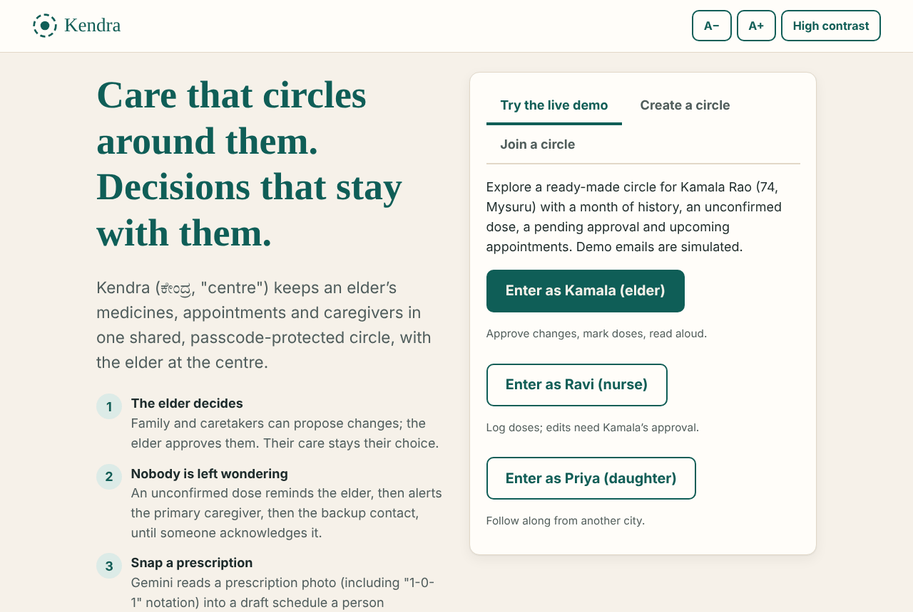
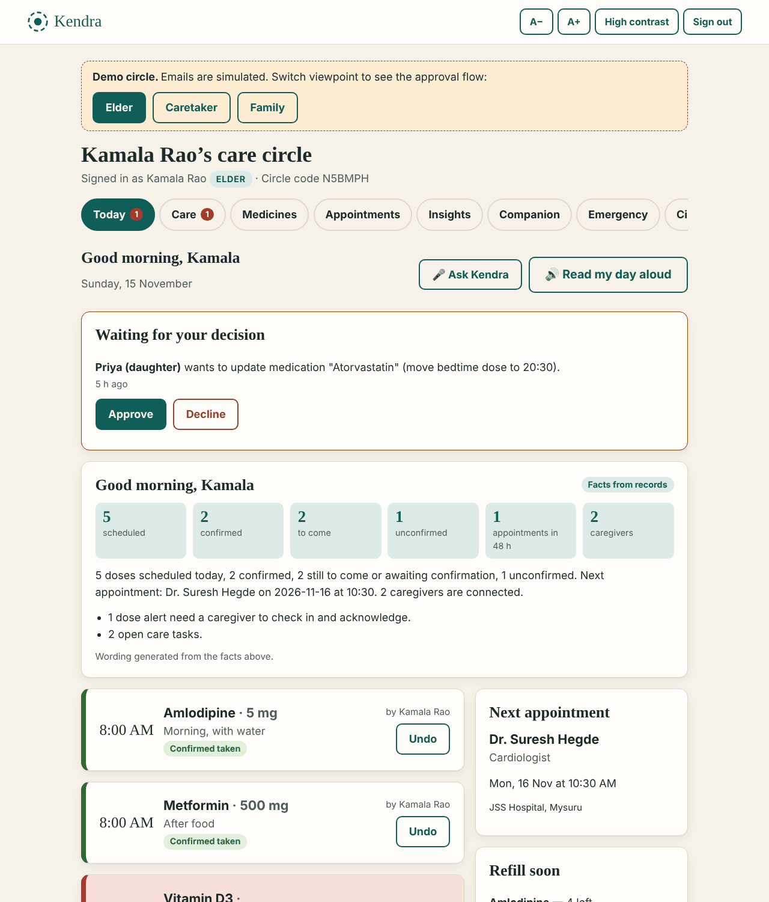
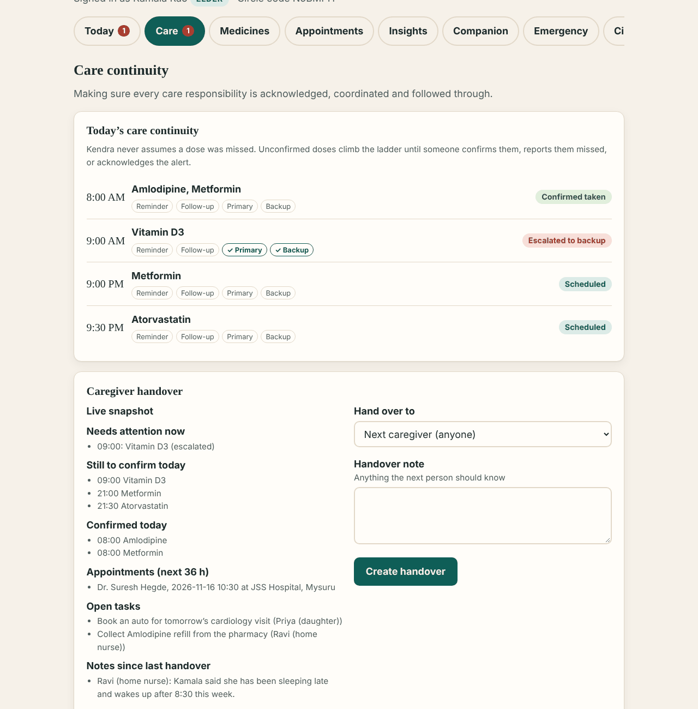
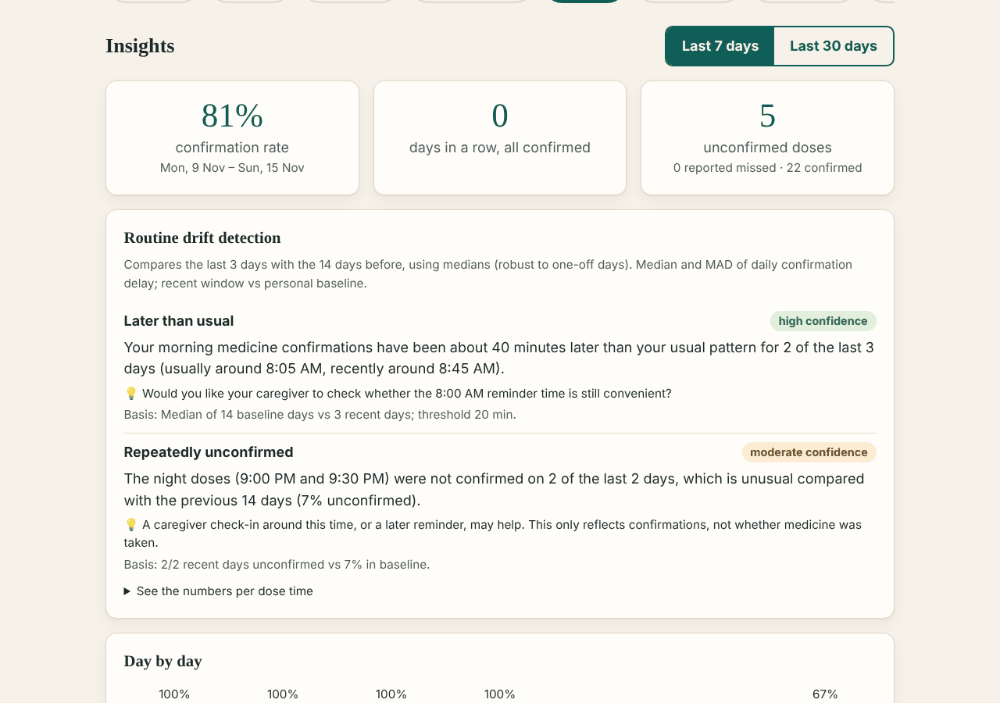
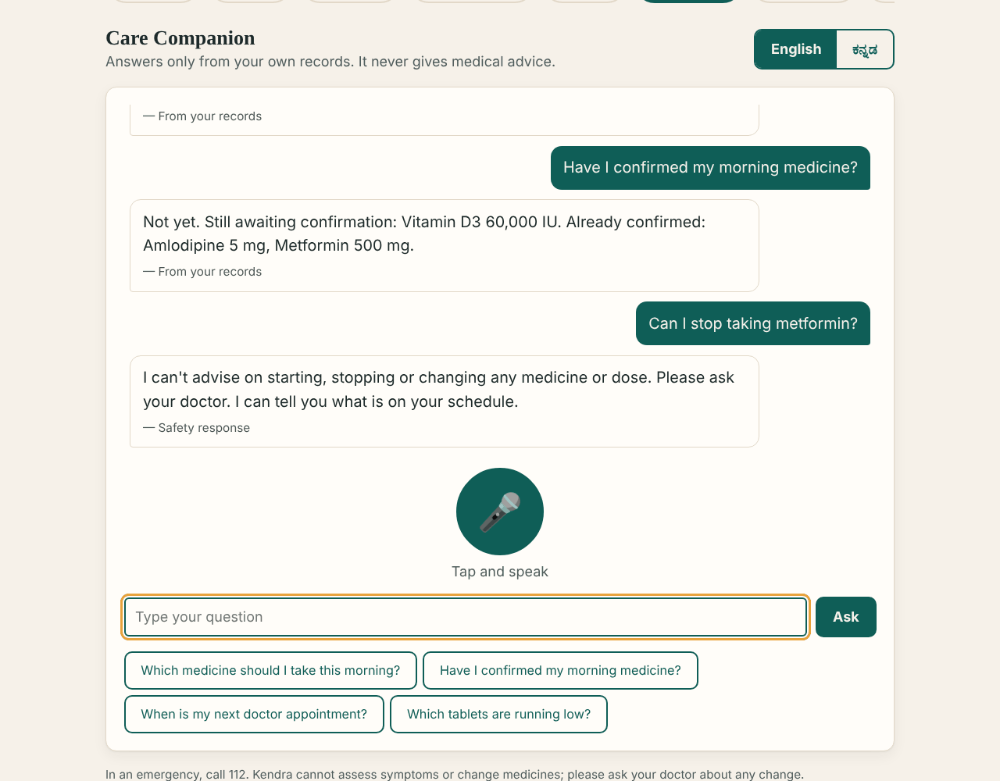
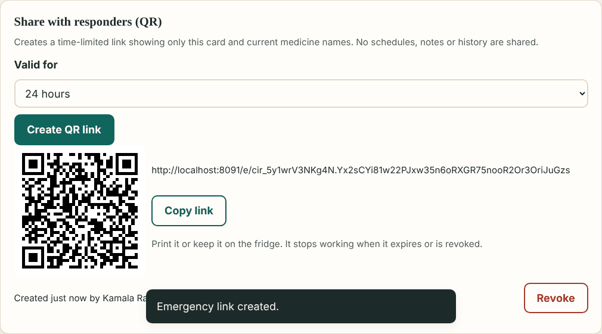
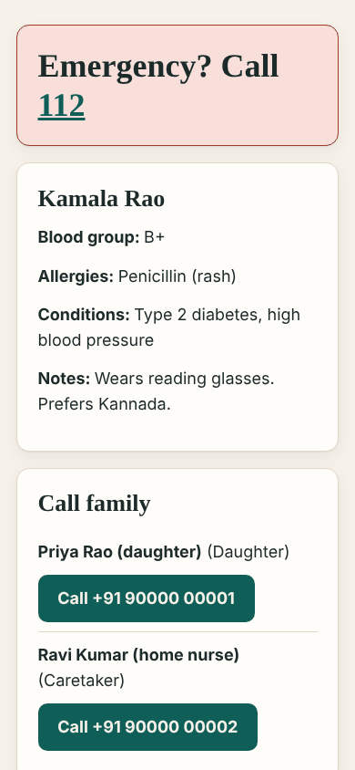
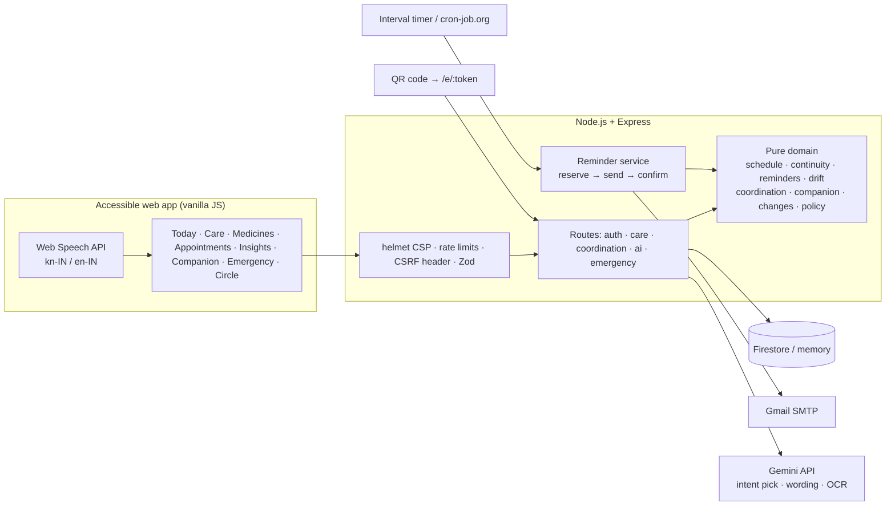
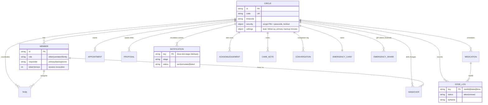

# Kendra: an elder-centred care circle

> **Care that circles around them. Decisions that stay with them.**

*Kendra* (ಕೇಂದ್ರ) means **"centre"** in Kannada. Kendra is a shared, passcode-protected platform where an elderly person, their caregivers and their family manage medications, appointments and daily routines together. It does more than send reminders: **it makes sure important care responsibilities are acknowledged, coordinated and followed through**, while the elder stays at the centre of every decision.

Built for **PromptWars × Catalyst: Elderly Care & Medication Management Platform** (Google for Developers × Hack2skill).

**Live demo:** https://kendra-care.onrender.com . Click **"Try the live demo"** to open a seeded circle as the elder, the caretaker or the family member. No sign-up is needed, and you can switch viewpoint at any time.



---

## 1. Problem analysis

The brief asks for medication, appointment and routine management shared between an elder, caretakers and family, with email reminders and the elder at the centre. Ordinary reminder apps fail in four predictable places:

1. **The reminder is the end of the story.** If the elder doesn't respond, nobody else finds out until much later.
2. **Silence is treated as a fact.** Many apps mark a dose "missed" when nobody tapped a button. That is a guess, and it erodes trust.
3. **Caregivers change shifts and context is lost.** Who confirmed what? Is transport booked for tomorrow's visit?
4. **The elder is managed rather than included.** Family edit schedules without the elder knowing, and the interface is not built for older eyes, ears or languages.

## 2. The solution and key innovations

| | What it does | Where the logic lives |
|---|---|---|
| **Care Continuity Engine** | An event-driven escalation ladder for each dose time: reminder → follow-up → **primary caregiver** → **backup contact**. A caregiver **acknowledgement** stops further escalation. Every step is de-duplicated, status-tracked and visible on a timeline. | `src/domain/continuity.js`, `src/domain/reminders.js`, `src/services/reminderService.js` |
| **Honest dose statuses** | *Confirmed taken*, *Reported missed* (explicit only), *Unconfirmed* (a labelled policy, never treated as missed), *Due*, *Upcoming*, plus care states *Reminder sent → Awaiting confirmation → Caregiver notified → Escalated → Caregiver acknowledged*. | `src/domain/schedule.js`, `src/domain/continuity.js` |
| **Routine drift detection** | Statistics, not an LLM: the median and MAD of each dose time's confirmation delay over the elder's own 14-day baseline, compared with the last 3 days. It flags confirmations that are consistently later than usual and repeated unconfirmed doses, with confidence levels and insufficient-data warnings. | `src/domain/drift.js` |
| **Smart caregiver handover** | A handover stores a **live snapshot** taken from the records (confirmed, pending, open alerts, appointments in the next 36 hours, open tasks, new notes). The next caregiver acknowledges it. Tasks can be assigned, completed and transferred. | `src/domain/coordination.js` |
| **Bilingual voice Care Companion (English + ಕನ್ನಡ)** | Speech in, speech out. Answers come only from a **fixed tool layer** over the signed-in elder's records. A safety screen refuses dosage advice and routes emergencies to 112. Gemini may only *pick an intent* from a closed list when the rules find none; it never writes the facts. | `src/domain/companion.js`, `public/js/views/companion.js` |
| **Daily care brief** | Facts are computed from records and shown separately from the wording (written by Gemini, or by rules as a fallback). It can be emailed to the circle. | `src/services/insights.js`, `src/services/ai.js` |
| **Elder consent** | Edits by caretakers and family become proposals that only the elder approves (the elder can switch this off). Only the elder manages members, escalation roles and the emergency card. | `src/domain/changes.js`, `src/domain/policy.js` |
| **Account recovery** | A forgotten elder PIN is reset with a one-time code emailed to the elder's address on file: scrypt-hashed, 15-minute expiry, 5 attempts, single use, with identical responses for unknown circles. | `src/http/routes/auth.js` |
| **Emergency card with QR** | Consent-based and time-limited (1–72 hours). Only a SHA-256 hash of the link secret is stored. Views are counted, links can be revoked, and the public view shows limited fields only. | `src/domain/emergency.js` |
| **Prescription scan** | Gemini reads a prescription photo into *drafts*. Indian "1-0-1" / BD / TDS notation is converted to clock times by deterministic code, and a person confirms everything before it is saved. | `src/services/ai.js`, `src/domain/frequency.js` |

### Screenshots

| Elder's day (simplified view) | Care continuity and handover |
|---|---|
|  |  |
| **Routine drift detection** | **Care Companion (ಕನ್ನಡ + English)** |
|  |  |
| **Emergency QR link** | **What a responder sees (mobile)** |
|  |  |

## 3. Original requirements → implementation

| Requirement | Implemented as | Verified by |
|---|---|---|
| Manage daily medications | Schedules by time, weekday and date range; pause/resume; stock countdown with refill alerts | `tests/domain.test.js`, `tests/api.test.js` |
| Medical appointments | CRUD, Google Calendar link, Google Maps directions, 24-hour and 2-hour reminders | `tests/reminders.test.js` |
| Shared ecosystem: elder, caretakers, family | Role model plus per-member escalation role (primary / backup / none) | `tests/api.test.js` |
| Secure passcode-based access | Elder 6-digit PIN plus a separate circle passcode (scrypt-hashed); lockout; rotation; instant revocation; PIN recovery by emailed one-time code | `tests/api.test.js`, `tests/services.test.js` |
| View, add, edit and manage schedules | REST API with strict validation and elder approval flow | `tests/api.test.js`, `tests/schemas.test.js` |
| Track adherence | 7- and 30-day confirmation rates, per medicine and per time of day, streaks, drift detection | `tests/domain.test.js`, `tests/features.test.js` |
| Monitor upcoming appointments | Dashboard, companion answers, handover snapshot, daily brief | `tests/features.test.js` |
| Email reminders: missed medications, upcoming doses, appointments | Gmail SMTP through the de-duplicated escalation engine | `tests/reminders.test.js` |
| Beyond a basic reminder app | Continuity engine, drift detection, handover, bilingual companion, emergency QR | all suites |
| Elder at the centre | Consent proposals; elder-only circle, responder and emergency-card control | `tests/domain.test.js`, `tests/api.test.js` |

## 4. Technology choices

| Layer | Choice | Why |
|---|---|---|
| Backend | **Node.js 22 + Express**, CommonJS, 6 runtime dependencies | One small, well-understood service that serves the API and UI, runs the scheduler, and deploys free in minutes |
| Frontend | **Vanilla JS ES modules, no build step** | Nothing to compile, tiny payload, strict CSP (`script-src 'self'`), fast on low-end phones |
| Validation | **Zod** (strict schemas) | Typed runtime validation that rejects unknown fields |
| Storage | **Cloud Firestore** (free Spark plan) via a hybrid store | Real circles persist in Firestore with transactional `update(id, mutator)` that skips unchanged writes; demo circles stay in memory so evaluators never consume the free quota. Same repository interface everywhere |
| AI | **Gemini API** (`gemini-2.5-flash`, configurable) over REST | JSON-schema output; isolated in `src/services/ai.js`; every feature degrades gracefully without a key |
| Email | **Nodemailer → Gmail SMTP** (App Password) | Real delivery with no paid service. Without credentials, emails are logged, never claimed as sent |
| Voice | **Web Speech API** (`kn-IN`, `en-IN`) | Speech-to-text and text-to-speech run in the browser at no cost |
| Testing | **node:test** + real HTTP integration tests | No test framework dependency; fake clock, store, mailer and AI injected |

The challenge suggested React, FastAPI and PostgreSQL as a *preferred direction*. Kendra deliberately keeps one runtime and one deployable unit, so a single reviewer can read the whole system and it runs reliably on a free tier. The domain core is pure functions over a plain data model, so a SQL repository could replace `src/data/` without touching business rules.

### Google technologies used

| Google service | How Kendra uses it |
|---|---|
| **Gemini API** | Prescription photo → structured drafts (JSON schema mode); daily and weekly brief wording grounded in computed facts; closed-list intent classification for the companion |
| **Cloud Firestore** (Firebase) | Persistent, transactional storage for real care circles |
| **Gmail (SMTP)** | Reminder, escalation, brief and PIN-recovery emails |
| **Google Calendar** | One-click "Add to Google Calendar" for appointments |
| **Google Maps** | One-click directions to the clinic |
| **Google Fonts** | Atkinson Hyperlegible, designed for low-vision readers |
| **Chrome Web Speech** | Kannada (`kn-IN`) and English speech recognition and synthesis |
| **Cloud Run-ready** | Non-root `Dockerfile` with health check; `/api/cron/tick` works with Cloud Scheduler |

## 5. Architecture



### Data model (one aggregate per care circle)



**Design decisions**
- **Pure domain core.** Scheduling, escalation, drift, coordination and companion answers are deterministic functions of `(circle, now)`, unit-tested with a fixed clock.
- **Timezone-correct.** Doses are wall-clock times in the elder's timezone (default `Asia/Kolkata`), so "8 AM" means 8 AM where the elder lives.
- **Exactly-once escalation.** Notification keys such as `dose:2026-11-16T08:00:primary` are reserved inside an atomic update *before* sending, so overlapping ticks or restarts never double-send. Doses older than 12 hours are never escalated after downtime.
- **Lazy migration.** `withDefaults()` upgrades older stored circles on read.
- **Free-tier aware.** Scheduler ticks that change nothing write nothing; the in-process tick runs every 2 minutes (every escalation window is at least 5 minutes wide); demo traffic never touches Firestore.

## 6. Responsible AI and safety

- **No fabricated facts.** Briefs, companion answers and insights come from computed data. AI only phrases them (briefs) or picks an intent from a closed enum (companion).
- **No medical advice.** The companion refuses questions about starting, stopping or changing medicines, in English and Kannada, and routes emergency phrases to 112 plus the elder's contact.
- **Honest uncertainty.** "Unconfirmed" is never shown as "missed". Drift insights show confidence and their statistical basis, and say "not enough history" rather than guessing.
- **Human in the loop.** Prescription scans produce drafts only. Caretaker and family edits need elder approval by default.
- **Graceful degradation.** Without a Gemini key, every feature still works (rule-based wording, rule-based intents) and the UI labels the source.
- **Prompt-injection hardening.** User text is passed as JSON data; all model output is validated with Zod and discarded if invalid.

## 7. Security and privacy

- scrypt-hashed PIN and passcode with constant-time comparison; per-IP rate limits; per-circle lockout (8 failures → 15 minutes); unknown codes take the same time to reject.
- HMAC-signed `httpOnly`, `Secure`, `SameSite=Strict` session cookies; membership is re-checked on every request; removal or passcode rotation takes effect instantly.
- CSRF header on every state-changing call; strict CSP; helmet headers; Permissions-Policy.
- One central role policy (`can(member, action, circle)`); elder-only management actions; addressee-only handover acknowledgement.
- Emergency links: 256-bit secrets, hash-only storage, expiry, revocation, view counting, `noindex`, limited fields, separate rate limit.
- Emails are sent BCC; secrets never reach the browser (tested); demo data is fictional and expires after 24 hours; `npm audit` is clean and runs in CI.
- Forgotten PINs are reset with a hashed, expiring, single-use emailed code. Full threat model: **[SECURITY.md](SECURITY.md)**.

## 8. Accessibility

**0 axe-core violations (WCAG 2.1 A/AA plus best practices) on all 9 screens.** The elder's Today view is deliberately simple: big "I took it" buttons, read-aloud, and a microphone. Also included: Atkinson Hyperlegible font, an 18 px base with an A+/A− scale up to 150%, a high-contrast theme, 48 px+ targets, a skip link, landmarks, live regions, keyboard-operable tabs, native `<dialog>`, field-linked errors, text alternatives for charts, `prefers-reduced-motion`, and a Kannada companion.

## 9. Demo walkthrough (about 5 minutes)

Click **Try the live demo → Enter as Kamala (elder)**. Kamala Rao (74, Mysuru) has 30 days of fictional history. Ravi (home nurse) is the primary caregiver and Priya (daughter) is the backup contact.

1. **Today:** see the daily brief (facts versus wording), confirm a dose with **I took it**, or **Report missed**.
2. The most recent past dose is left unconfirmed, and the **reminder ladder** shows the primary caregiver and backup contact were alerted (emails are simulated in the demo).
3. **Care:** the continuity timeline shows the escalation steps sent for each dose time.
4. Switch the demo bar to **Caretaker**, then click **Acknowledge** on the open alert and add a note. The state becomes *Caregiver acknowledged*.
5. **Care → Handover:** create a handover to Priya, switch to **Family**, and acknowledge it.
6. **Insights:** routine drift detection finds morning confirmations about 40 minutes later than usual and two unconfirmed nights. Switch to *Last 30 days*.
7. **Companion:** ask "When is my next doctor appointment?", then switch to ಕನ್ನಡ and ask "ನಾನು ಇವತ್ತು ಬೆಳಿಗ್ಗೆ ಔಷಧಿ ತೆಗೆದುಕೊಂಡಿದ್ದೇನಾ?". Try "Can I stop taking metformin?" to see the safety refusal.
8. **Emergency (as Elder):** create a QR link and open it on a phone.
9. Switch to **Caretaker** and edit a medicine. It becomes a proposal that **Kamala approves** on Today.

To start over, sign out and click "Try the live demo" again. Every demo is a fresh circle.

## 10. Testing

```bash
npm test               # 93 tests: unit + full HTTP integration
npm run test:coverage  # ≈97% line coverage
npm run lint           # ESLint, zero warnings
```

Covered scenarios include:
- registration and login, wrong passcodes, lockout, per-IP rate limiting, forged and stale sessions, PIN recovery (no enumeration, hashed one-time code, attempt limit, replay refused, old sessions revoked)
- unauthorized role actions (family editing settings or the emergency card, the elder acknowledging an alert, a non-addressee acknowledging a handover)
- adding and editing medicines, confirmation and explicit missed reports, idempotent logging and undo with stock sync
- reminder generation, follow-up, primary and backup escalation, acknowledgement stopping escalation, an unavailable primary, late confirmation, duplicate prevention, opted-out members, stale doses after downtime
- appointment creation and 24-hour/2-hour reminders, low stock, weekly brief timing
- drift detection (real drift, single outliers, normal variation, insufficient data, repeated unconfirmed)
- companion grounding in English and Kannada, unanswerable questions, dosage-advice refusal, emergencies
- handover snapshots, tasks, emergency links (expiry, revocation, hash-only storage, limited fields)
- Gemini schema rejection and fallbacks, CSRF, security headers, atomic store updates under concurrency
- the Firestore adapter (undefined-field safety, skipped no-op writes, credentials parsing) and the hybrid demo/real routing

CI (GitHub Actions) runs lint, tests with coverage, and `npm audit` on every push.

## 11. Setup

```bash
git clone <your-repo-url> kendra && cd kendra
npm install
cp .env.example .env       # all values are optional locally
npm start                  # http://localhost:8080
```

| Variable | Required | Purpose |
|---|---|---|
| `SESSION_SECRET` | production | 32+ random characters for signing sessions |
| `GEMINI_API_KEY` / `GEMINI_MODEL` | optional | Prescription scan, AI wording, companion intent fallback |
| `SMTP_USER` / `SMTP_PASS` / `MAIL_FROM` | optional | Gmail address plus App Password for real emails (otherwise emails are logged only) |
| `PUBLIC_URL` | recommended | Used in email buttons and QR links |
| `CRON_SECRET` | recommended | Protects `POST /api/cron/tick` |
| `FIREBASE_SERVICE_ACCOUNT` | optional | The downloaded Firebase service-account JSON, pasted as one value. Enables persistent Firestore storage; otherwise in-memory |
| `FIREBASE_PROJECT_ID` / `FIREBASE_CLIENT_EMAIL` / `FIREBASE_PRIVATE_KEY` | optional | Alternative to the single JSON variable |
| `DEFAULT_TIMEZONE` | optional | Defaults to `Asia/Kolkata` |

API reference: **[docs/API.md](docs/API.md)**.

## 12. Deployment (Render, free)

1. Push to GitHub, then on Render choose **New → Blueprint** and pick the repo. `render.yaml` generates `SESSION_SECRET` and `CRON_SECRET`.
2. Set `GEMINI_API_KEY`, `SMTP_USER`, `SMTP_PASS`, `PUBLIC_URL` and (for persistence) `FIREBASE_SERVICE_ACCOUNT`.
3. Free instances sleep when idle, so add a free **cron-job.org** job: `POST https://<app>/api/cron/tick` every 5 minutes with the header `X-Cron-Secret: <CRON_SECRET>`. This keeps reminders running and the app awake.

**Cloud Run:** `gcloud run deploy kendra --source . --region asia-south1 --allow-unauthenticated` (non-root `Dockerfile` with health check included), plus Cloud Scheduler for the tick.

## 13. Known limitations and future work

- Without Firestore configured, data is in memory and resets on restart (the demo rebuilds itself on every visit).
- One Firestore document per circle keeps reads cheap; a very large circle would eventually move dose history into a sub-collection.
- Kannada voice input depends on browser support (Chrome supports `kn-IN`); typing always works.
- A full Kannada interface beyond the companion; SMS/WhatsApp escalation; an installable PWA with push notifications.
- Not clinically validated. Kendra coordinates care and **never replaces a doctor's advice**.

## License

MIT, chosen so other student and community projects can reuse the care-continuity ideas.
